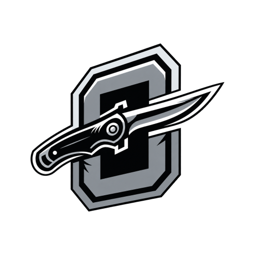
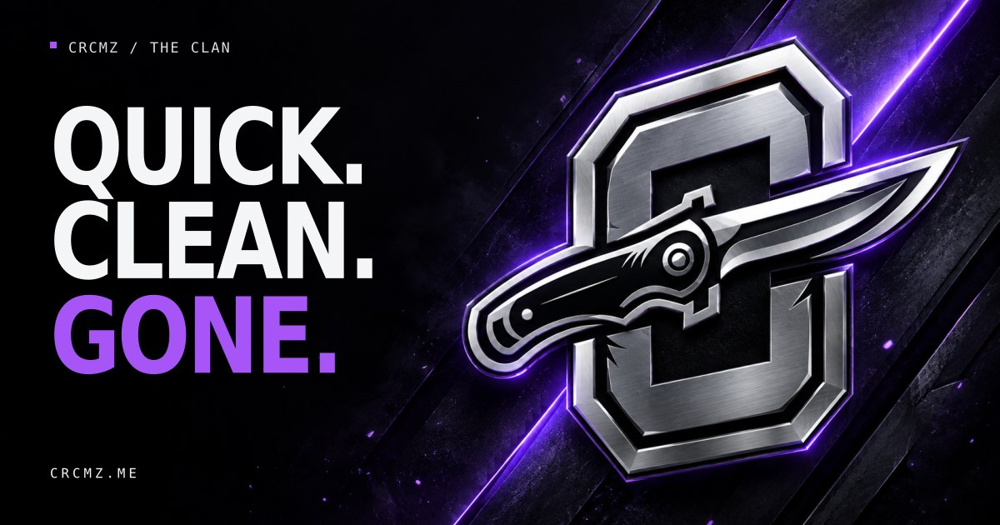

<div align="center">

<a href="https://crcmz.me">
  
</a>

# CRCMZ

### Command Ready Clan Management Zone

**Quick. Clean. Gone.**

Nine players. Two countries. One squad running on software it built itself.

[](https://crcmz.me)
[](https://app.crcmz.me)
[](https://bot.crcmz.me/vip)
[](https://discord.gg/BeWdfJkFqr)

🇨🇦 🇺🇸 &nbsp;·&nbsp; est. 2023 &nbsp;·&nbsp; Call of Duty on PlayStation



</div>

---

## 🎯 What this is

This repo is **[crcmz.me](https://crcmz.me)**, home base for the CRCMZ clan. Most clans have a Discord and a logo. We have an AI coach, a clip factory, a bot that knows everyone's K/D, and a bracket that fills itself in from screenshots. This site is where all of that lives.

## 🧰 The Loadout

Everything a CRCMZ member gets:

| | Perk | What it does |
|---|---|---|
| 🧠 | **AI Gameplay Coach** `beta` | Drop a clip and get coached on it. Clip analysis, live stream review, coaching for each game. |
| 📨 | **PSN Messenger** | Share on PSN and it shows up everywhere: WhatsApp, Discord and Mattermost, in real time. A montage comes out every month. |
| 🎮 | **PSN Chat Board** | The whole clan on one screen at [app.crcmz.me](https://app.crcmz.me). Group chat, quick party-ups, works mid-game. |
| 🤖 | **CRCMZ Bot** | One bot, three places to yell at it. Say `ai …` in PSN or WhatsApp, or use the Ask AI tab. It knows the squad's real stats, and you can teach it facts about each other. Runs on our own hardware. |
| 🍿 | **Watch Party** | Watch together, in sync, on app.crcmz.me. |
| 🏆 | **Tournaments** | Post the screenshot, the bracket does the rest. AI reads results into live brackets, standings and K/D for each player, then announces them in WhatsApp. |
| 🏭 | **[The AI Factory](https://crcmz.me/factory.html)** | *We play. The Factory ships.* Drop a PlayStation clip in the squad chat and it gets cut, captioned, coached and posted to Instagram, TikTok and YouTube. No editing, no exporting. |

### 👑 VIP, every perk on day one

> Instant membership (skip tryouts) · VIP Discord role · listed on crcmz.me with a custom AI avatar · lobby priority & voting · online-status highlights · meta loadout bots · monthly COD giveaways · Mattermost access
>
> **[→ Unlock VIP](https://bot.crcmz.me/vip)**

## 🗺️ Pages

| Route | What's there |
|---|---|
| [`/`](https://crcmz.me) | The main site: hero, The Loadout, About Us, Clan Members |
| [`/factory.html`](https://crcmz.me/factory.html) | The AI Factory, the clip-to-socials pipeline |
| [`/brand`](https://crcmz.me/brand) | Official brand kit (Media Kit Edition 01): crest, wordmarks, palette, banners, stream overlays |
| [`/beta.html`](https://crcmz.me/beta.html) | The animated scroll redesign in progress |
| `/success.html` · `/cancel.html` | VIP checkout result pages |
| [`history.crcmz.me`](https://history.crcmz.me) | Clan History |

## ⚙️ Under the hood

No framework and no build step. Plain HTML, CSS and JS, served by **GitHub Pages** behind Cloudflare.

```
index.html            main site
factory.html          The AI Factory
brand.html            brand kit  (served at /brand)
beta.html             redesign in progress
css/ js/ style.css    styles + scripts
img/brand/            official CRCMZ assets (crests, banners, overlays)
img/og-*.{jpg,png}    social share cards
.well-known/          passkey links for the CRCMZ iOS + Android apps
CNAME                 crcmz.me
```

The `.well-known/` files (`apple-app-site-association` and `assetlinks.json`) let crcmz.me passkeys work inside the CRCMZ iPhone and Android apps. Don't move them.

## 🚀 Run it / ship it

```bash
git clone https://github.com/moiz-qureshi/crcmz-coming-soon.git
cd crcmz-coming-soon
python3 -m http.server 8080      # → http://localhost:8080
```

To deploy, push to `main`. GitHub Pages publishes it to crcmz.me within a minute or two.

## 🙏 Credits

Built by the squad, for the squad. The site started from [Vinod Jangid's portfolio template](https://github.com/vinodjangid07/vinodjangid07.github.io) (MIT) and has since been rebuilt for CRCMZ. Scroll animations by [AOS](https://github.com/michalsnik/aos).

<div align="center">

---

**CRCMZ** · Command Ready Clan Management Zone · 🇨🇦🇺🇸

*Quick. Clean. Gone.*

</div>
